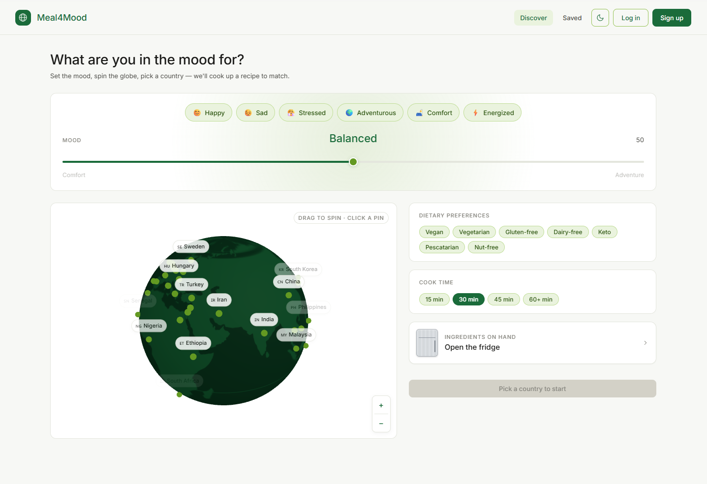
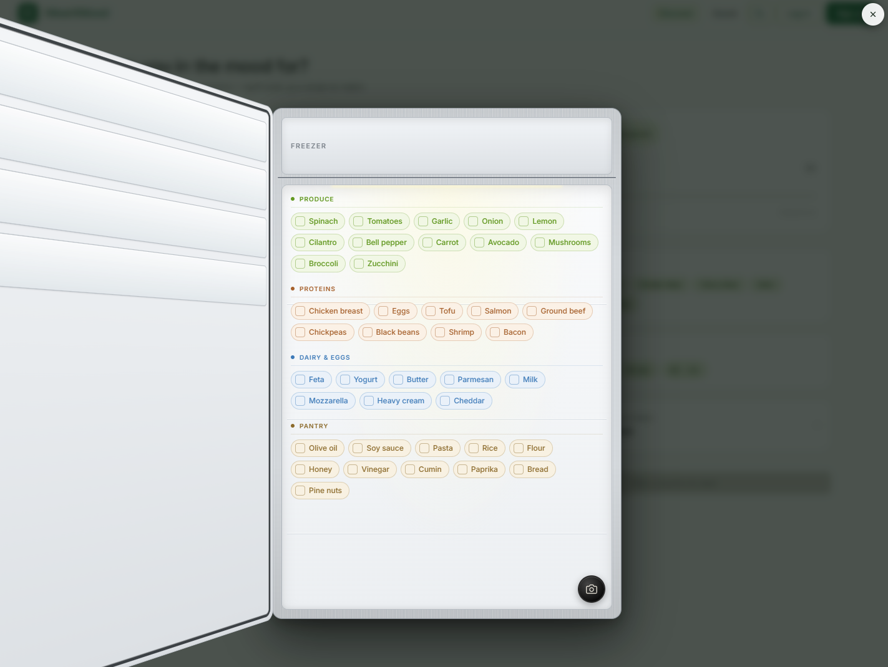

# Meal4Mood

An AI-powered recipe web app that recommends personalized recipes based on your mood, the cuisine you pick from a 3D globe, your dietary preferences, your cook time, and the ingredients in your fridge.

**▶ Live demo: [meal4mood-eta.vercel.app](https://meal4mood-eta.vercel.app)** — no sign-up needed.

---

## The problem

"What should I cook tonight?" is a daily decision most people answer badly: the same five dishes on rotation, or takeout because nothing sounds right. Recipe sites search by ingredient or cuisine, but people choose food by **how they feel** — something soft and warm after a stressful day, something loud and spicy when they're restless. Meal4Mood turns that feeling into a concrete, authentic recipe from anywhere in the world, built around what's already in the fridge, and lets you keep refining it with the AI chef until it's exactly what you want.

---

## Screenshots

| Set the mood, spin the globe | Scan or pick your ingredients |
| --- | --- |
|  |  |

---

## Team

| Name | Role |
| --- | --- |
| **Nhat Pham** | Project Manager / Developer |
| **Quan Cao** | Business Analyst / QA |

---

## Running locally

Create `.env.local` with:

```
ANTHROPIC_API_KEY=...
PEXELS_API_KEY=...   # optional — recipe images fall back to a placeholder without it
```

Then:

```bash
npm install
npm run dev
```

The app will run on `http://localhost:3000`.

---

## Tech stack

- **Next.js 16** (App Router) + **React 19** + **TypeScript**
- **Tailwind CSS v4**
- **Three.js** + **React Three Fiber** — 3D globe for cuisine selection
- **Framer Motion** — transitions and UI animations
- **Claude Haiku 5.5** via the Anthropic TypeScript SDK — recipe generation, iterative refinement and fridge-photo vision, using structured outputs and prompt caching
- **Zod** — output schemas for the AI and validation of every API request
- **Pexels API** — food photography per recipe
- **localStorage** — saved recipes, no account needed

---

## Prompt engineering

Every AI call combines several prompt patterns. The app's **Under the hood** panel shows, for each recipe, which patterns were used, the exact prompt that was sent, token counts and cost.

| Pattern | Where | How it's used |
| --- | --- | --- |
| **Persona** | [`recipePrompt.ts`](src/lib/prompts/recipePrompt.ts), [`fridgePrompt.ts`](src/lib/prompts/fridgePrompt.ts) | Recipes come from *Chef Mira*, a globe-trotting chef who writes for home cooks — this sets tone, expertise and a standard of authenticity. The fridge scanner is a *meticulous kitchen-inventory assistant*, so it names ingredients the way a cook would. |
| **Few-shot** | `RECIPE_SYSTEM_PROMPT`, `FRIDGE_SYSTEM_PROMPT` | Two worked recipe examples (a cozy Japanese bowl, a wild vegan Mexican dish) show the quality bar and how mood maps to food; a worked scan example shows naming style and confidence ratings. |
| **Iterative refinement** | [`refine-recipe` route](src/app/api/refine-recipe/route.ts) | "Remix with the chef" replays the original request and Claude's own recipe as a real conversation, then sends the user's tweak ("make it spicier", "swap the chicken for shrimp") as the next turn. Claude edits its work instead of starting over and explains what it changed. |
| **Template / structured output** | `RecipeSchema`, `FridgeScanSchema` | Zod schemas are enforced by the API's structured outputs, so every response has exactly the fields the UI needs — no JSON-parsing retries. |
| **Context & constraints** | `buildRecipeUserMessage` | A mood palette maps the 0–100 slider to food styles; diet is a hard constraint; cook time is a cap; fridge items are preferred but authenticity comes first. |
| **Input guarding** | `<user_input>` tags + [`validate.ts`](src/lib/validate.ts) | Free text from users is wrapped in tags and the system prompt says to treat it as data, so "ignore your rules" in the ingredient box does nothing. The server looks up cuisine and dishes from its own data and never trusts the client's. |

### Cost

| | Before | Now |
| --- | --- | --- |
| Model | Claude Haiku 4.5 ($1 / $5 per M tokens) | Claude Haiku 5.5 ($0.10 / $0.50 per M tokens) |
| Recipe | ~$0.003–0.004 (estimated), plus a full retry when the JSON didn't parse | **~$0.0004** measured, with the system prompt served from cache |
| Remix | — | ~$0.001 |
| Fridge scan | full-size phone photo | **~$0.0005**, photo downscaled to 1024px in the browser first |

What brings the cost down:

- **Prompt caching** — the ~2,700-token system prompt (persona, rules, few-shot examples) never changes, so it is cached; repeat requests pay 10% for it.
- **Low effort** — the tasks are well specified and schema-constrained, so the model's thinking is kept short.
- **Structured outputs** — no wasted retries on malformed JSON.
- **Smaller photos** — fridge photos are resized before upload, roughly halving image tokens.
- **Rate limiting** — each IP gets a request budget per 10 minutes, so nobody can drain the API key on the public demo.

---

## Features

### Core flow

- **Mood slider** — 0–100 scale with descriptive presets that change as you slide: *Cozy → Soothing → Mellow → Steady → Balanced → Lively → Bold → Daring → Wild → Unhinged*. The selected word styles itself (italics, weight, glow) to match its vibe.
- **3D interactive globe** — 50 country pins on a textured globe you can drag to spin. Click a pin to open a confirmation card showing the cuisine and three signature dishes from that country.
- **Country confirmation card** — Animated preview before generating, with a dismiss option so you can keep exploring.
- **Dietary preferences** — Multi-select chips for Vegetarian, Vegan, Dairy-Free, Gluten-Free, Keto, Pescatarian and Nut-Free.
- **Cook time selector** — 15 / 30 / 45 / 60+ minute buckets.
- **Fridge ingredient picker** — Type or pick ingredients you already have on hand. The AI builds around them where it makes sense and reports which ones it used.
- **Fridge photo scanner** — Snap a picture of your fridge or pantry and Claude's vision returns the ingredients it can see, with low-confidence guesses filtered out.
- **AI recipe generation** — Mood (and how you say you feel), country, diet, cook time and fridge items go to Claude, which returns a structured recipe: title, description, why it fits your mood, difficulty, cook time, servings, calories, ingredients, steps and a chef's tip.
- **Remix with the chef** — One-tap tweaks (spicier, faster, vegetarian, fewer ingredients, kid-friendly, fancier) or free-text requests revise the current recipe, with a "Chef's changes" note and version number.
- **Under the hood** — Shows the prompt patterns used, the exact prompt sent, token counts, cache hits, latency and the cost of each call and of the session.
- **Food photo lookup** — Searches Pexels with three progressively broader queries (dish-specific → cuisine-level → generic plated food) and falls back to a placeholder if nothing matches.
- **Recipe card** — Matched photo, country flag, difficulty, calories, the mood match, numbered steps, chef's tip and a grocery checklist with your fridge items pre-ticked.

### Saved recipes

- **Save recipes** with one click — stored in the browser's localStorage, so there's no sign-up between you and dinner.
- **Saved recipes page** at `/saved` — grid layout, expand to view, per-card delete with animated removal.

### Polish

- **Dark mode** with a `useTheme` hook and localStorage persistence.
- **Quick pick ticker** on the home page — a scrolling row of signature dishes from around the world; tap one to generate it straight away.
- **Nearby restaurants by cuisine** — Uses browser geolocation to surface real restaurants matching the generated recipe's cuisine, sorted by distance.

---

## File structure

```
src/
  app/
    api/
      generate-recipe/   # AI recipe generation + Pexels image lookup
      refine-recipe/     # Iterative refinement ("Remix with the chef")
      scan-fridge/       # AI vision fridge/pantry photo analysis
    saved/               # Saved recipes page
    page.tsx             # Main app — mood, globe, selectors, recipe output
    layout.tsx           # Root layout
  components/
    Globe.tsx            # Three.js 3D globe with 50 country pins
    MoodSlider.tsx       # Mood slider with descriptive presets
    CountryConfirmCard.tsx
    DietarySelector.tsx
    CookTimeSelector.tsx
    FridgeSelector.tsx
    FridgeScanner.tsx
    RecipeCard.tsx
    RemixBar.tsx         # One-tap and free-text recipe tweaks
    UnderTheHood.tsx     # Prompt patterns, exact prompt, tokens and cost
    RecipeSkeleton.tsx
    SavedCard.tsx
    Navbar.tsx
    QuickPickTicker.tsx
    NearbyRestaurants.tsx
    LogoMark.tsx
  lib/
    prompts/             # Recipe + fridge-scan prompts and output schemas
    ai.ts                # Claude client, model/effort settings, cost accounting
    validate.ts          # Request validation and prompt-input sanitizing
    rateLimit.ts         # Per-IP request budget
    pexels.ts            # Food photo lookup
    mood.ts              # Mood words shared by the UI and the prompt
    savedRecipes.ts      # localStorage helpers for saved recipes
    types.ts             # Shared TypeScript types
  hooks/
    useTheme.ts

workflows/               # Markdown SOPs documenting each major feature
public/                  # Logo, icons, favicons
country-cuisine-map.json # Country → cuisine + flag + signature dishes
```

---

## Build journey

The project came together in a deliberate order so each layer had something real to lean on:

1. **Phase 1 — Market research.** Validated the idea: people genuinely want a recipe app that meets them where their mood is, not just what's in the fridge.
2. **Phase 2 — Mood slider first.** Built the emotional anchor of the app: the slider that turns a feeling into a parameter. The descriptive word presets (Cozy → Unhinged) and the styling-per-mood came out of wanting the UI itself to feel the mood you picked.
3. **Phase 2 — Fridge picker and scanner next.** Wired up the ingredient selector and the AI vision photo scanner so by the time generation existed, the AI already had real ingredients to work with.
4. **Phase 2 — 3D globe.** Made cuisine selection feel like exploration instead of a dropdown. Started with a handful of countries, expanded to 50 with proper flags, lat/lon coordinates, and signature dish lists.
5. **Phase 2 — Recipe generation pipeline.** Connected the AI generation route with structured JSON output and a retry on parse failures. Layered Pexels image lookup with a three-tier query fallback so every recipe gets a believable photo. Closed the loop with one-click saves so users could keep a personal recipe collection.
6. **Final polish.** Dark mode, the quick-pick ticker for users who want one-tap inspiration, and the nearby-restaurants feature that turns a recipe idea into "or just go out tonight."
7. **Phase 3 — Prompt engineering and cost.** Moved to Claude Haiku 5.5 with structured outputs and prompt caching; added the Chef Mira persona, few-shot examples and input guarding; built "Remix with the chef" for iterative refinement and the "Under the hood" panel; dropped accounts in favour of in-browser saves so anyone can try it instantly.

---

## License

Released under the [MIT License](LICENSE). © 2026 Nhat Pham and Quan Cao.
